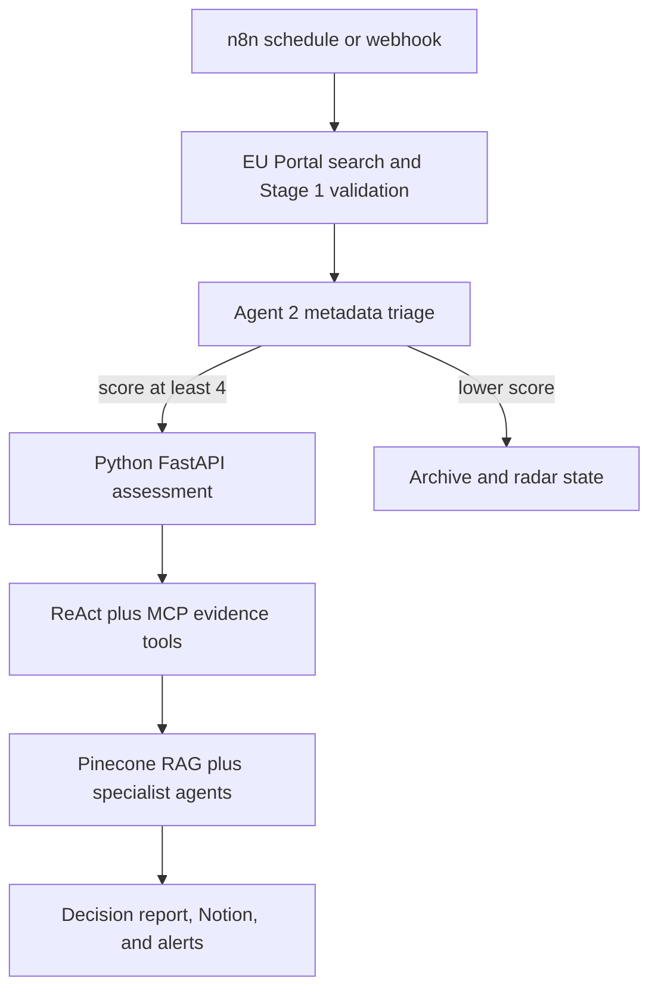

# EU Energy Tender Autonomous Decision System

A hybrid n8n + Python system that discovers ongoing and forthcoming **Energy** calls in the EU Funding &
Tenders Portal, validates and triages each listing, acquires detailed evidence, and produces an autonomous,
auditable **BID / CONDITIONAL_BID / NO_BID** strategic assessment.

The package preserves the working Stage 1–2 n8n workflow and adds an executable Python service for ReAct,
LangGraph, Pinecone RAG, MCP tools, specialist assessment agents, report generation, validation, and monitoring.

## What is working

- Deterministic offline demo: works without paid APIs and generates three complete reports.
- Production integrations: Anthropic reasoning, OpenAI embeddings, Pinecone retrieval, MCP v2 stdio tools,
  FastAPI, and n8n HTTP orchestration.
- Four n8n exports: verified Stage 1–2, a 43-node hybrid orchestrator, a 3-node error monitor, and a 43-node
  Stage 10–15 strategic-development sub-workflow.
- Explicit ReAct reason/action/observation loop, not merely a classification prompt.
- Explicit LangGraph state with conditional routing.
- Seven MCP tools, exceeding the minimum of three.
- Structured JSONL audit events, validation, controlled fallbacks, n8n error routing, and Slack alerts.
- Three report examples covering two strong energy opportunities and one irrelevant procurement.

> The `EU-DEMO-*` tender records are presentation fixtures, not claims about live portal records. The laptop
> record reproduces the structure observed during workflow development. Always verify live records and annexes.

## Architecture



n8n owns scheduling, source search, coarse routing, webhooks, persistence, and operational monitoring.
Python owns stateful reasoning, specialist tools, retrieval, calculations, report quality, and traceability.
This split keeps the visible automation canvas understandable without forcing advanced agent behavior into
large prompt nodes.

For a complete input, output, process-role, and autonomy analysis of every node in the 60-node integrated
Stages 1 to 4 workflow, see [`docs/STAGES_1_4_NODE_AUDIT.md`](docs/STAGES_1_4_NODE_AUDIT.md).

For the consolidated project conversation, troubleshooting history, architecture evolution, and implementation
decisions, see [`docs/COMPLETE_CHAT_PROJECT_RECORD.md`](docs/COMPLETE_CHAT_PROJECT_RECORD.md).

## Repository layout

```text
eu-tender-autonomous-agent/
├── README.md
├── requirements.txt
├── pyproject.toml
├── .env.example
├── src/tender_agent/
│   ├── api.py, cli.py, config.py, schemas.py, state.py
│   ├── graph.py                 # LangGraph supervisor
│   ├── react_agent.py           # explicit reason/action/observation loop
│   ├── offline_workflow.py      # deterministic, executable fallback/demo
│   ├── agents/                  # specialist scoring agents
│   ├── mcp_tools/               # MCP v2 server and client
│   ├── rag/                     # Pinecone and local retrieval
│   ├── reports/                 # report renderer
│   └── tools/                   # tested procurement calculations
├── notebooks/end_to_end_demo.ipynb
├── workflows/n8n/
│   ├── stages_1_2_integrated.json
│   ├── stages_1_4_integrated.json
│   ├── full_autonomous_orchestrator.json
│   ├── stage_3_react_detail_acquisition.json
│   ├── stage_4_document_extraction_ingestion.json
│   ├── stages_3_9_visible_orchestrator.json
│   ├── error_monitor_workflow.json
│   └── future_development_orchestrator.json
├── data/company_profiles, data/tender_samples, data/knowledge
├── reports/examples/
├── tests/
├── scripts/
├── diagrams/
└── docs/
```

## Mac M4 setup (macOS 27)

The complete VS Code and Mac mini execution guide is available as an executable notebook:

[`notebooks/complete_project_execution_macos27.ipynb`](notebooks/complete_project_execution_macos27.ipynb)

It includes Apple Silicon preparation, environment creation, deterministic execution, FastAPI, Docker n8n,
live ReAct, Pinecone, MCP, Notion, Slack, monitoring, and presentation checks.

### 1. Install command-line prerequisites

Install [Homebrew](https://brew.sh/) if required, then run:

```bash
brew install python@3.12 node@22 git
cd eu-tender-autonomous-agent
chmod +x scripts/setup_macos.sh scripts/run_demo.sh
./scripts/setup_macos.sh
source .venv/bin/activate
```

Python 3.11 or 3.12 is recommended. Avoid mixing the Homebrew interpreter with Apple's system Python.

### 2. Configure secrets

```bash
cp .env.example .env
```

Edit `.env` in VS Code. Do not commit it.

- `ANTHROPIC_API_KEY`: Claude reasoning in live mode.
- `OPENAI_API_KEY`: embeddings in the included Pinecone configuration.
- `PINECONE_API_KEY`, `PINECONE_INDEX`, `PINECONE_NAMESPACE`: RAG storage.
- `N8N_SHARED_SECRET`: shared secret used by n8n's HTTP Request node.
- `AGENT_MODE=demo` for the deterministic demo; change to `live` after keys and index are ready.

A ChatGPT or Codex subscription is not automatically an OpenAI API key. Use an API key from the appropriate
developer platform if OpenAI embeddings are enabled.

### 3. Run the no-key autonomous demo

```bash
export PYTHONPATH="$PWD/src"
python scripts/verify_project.py
./scripts/run_demo.sh
jupyter lab notebooks/end_to_end_demo.ipynb
```

Expected decisions:

| Fixture | Expected outcome |
|---|---|
| Public building energy performance | BID or CONDITIONAL_BID |
| AI data-centre energy efficiency | BID or CONDITIONAL_BID |
| Business laptops for an energy regulator | NO_BID |

### 4. Configure Pinecone RAG

1. Create a Pinecone dense index named `eu-tender-energy` with the dimension required by the selected
   embedding model (`text-embedding-3-small` uses 1536 dimensions).
2. Set the Pinecone and OpenAI variables in `.env`.
3. Activate the environment and load `.env` into your shell.
4. Run:

```bash
export $(grep -v '^#' .env | xargs)
export PYTHONPATH="$PWD/src"
python scripts/ingest_pinecone.py
```

The live retriever uses `PineconeVectorStore`; if Pinecone is temporarily unavailable, it records degraded
operation and uses the controlled local corpus so the workflow can continue safely.

### 5. Start the Python API

```bash
export $(grep -v '^#' .env | xargs)
export PYTHONPATH="$PWD/src"
uvicorn tender_agent.api:app --host 0.0.0.0 --port 8000 --reload
curl http://127.0.0.1:8000/health
```

Interactive API documentation is at `http://127.0.0.1:8000/docs`.

### 6. Start n8n on Apple Silicon

For a local demonstration, install Docker Desktop for Apple Silicon and run:

```bash
docker volume create n8n_data
docker run --rm -it --name n8n -p 5678:5678 \
  -e GENERIC_TIMEZONE=Europe/Berlin \
  -e TZ=Europe/Berlin \
  -v n8n_data:/home/node/.n8n \
  docker.n8n.io/n8nio/n8n
```

Open `http://localhost:5678`, create the owner account, and import
`workflows/n8n/full_autonomous_orchestrator.json`.

For a presentation in which every autonomous assessment stage must appear on the canvas, also import
`workflows/n8n/stages_3_9_visible_orchestrator.json`. It exposes Agents 3 to 9 as separate n8n HTTP and
validation nodes while each request executes the corresponding compiled LangGraph subgraph. Follow
`docs/STAGES_3_9_N8N_EXECUTION.md` to connect it after the Stage 2 high-relevance handoff.

If n8n runs on a remote server, `127.0.0.1:8000` points to that server, not your Mac. Deploy the FastAPI service
to an address reachable by n8n or use a temporary HTTPS tunnel for the demo. Never expose the endpoint without
the shared-secret header and TLS.

### 7. Configure imported n8n nodes

1. Select credentials in the OpenAI, Anthropic, Notion, and Slack nodes.
2. Set `tenderAgentBaseUrl` in the workflow runtime configuration node. Use
   `http://host.docker.internal:8000` for local Docker n8n, or an authenticated public HTTPS service URL for
   hosted n8n. Keep the canonical `companyId` value `i@work`.
3. Create a Generic Header Auth credential with header name `X-N8N-Secret` and the same value as the Python
   service's `N8N_SHARED_SECRET`. Select it in every Python-agent HTTP Request node.
4. In all Notion nodes select the same **Find Tender Radar** database.
5. Confirm its properties and types exactly match `docs/N8N_WORKFLOW.md`.
6. Keep the schedule timezone `Europe/Berlin`.
7. Publish the workflow to activate the Schedule Trigger and production Webhook URL.
8. Import `error_monitor_workflow.json`, select its Slack credential, then select it as the main workflow's
   **Error Workflow** in workflow settings.
9. Test one pinned item before executing all results.
10. Test `GET /health`, then the webhook, then the daily schedule.

The updated exports do not use `$env` inside n8n nodes. This prevents `access to env vars denied` on hosted
n8n installations that block node-level environment-variable access.

The webhook endpoint is shown by n8n after import. Its path is `/webhook/eu-tender-assess` when the workflow
is published and `/webhook-test/eu-tender-assess` during editor testing.

## API contract

`POST /assess` with header `X-N8N-Secret`:

```json
{
  "tender": {
    "recordId": "EU-DEMO-ENERGY-BUILDINGS-001",
    "title": "Strengthening the Energy Performance of Public Building Stock",
    "status": "Open for submission",
    "externalKey": "EU-DEMO-ENERGY-BUILDINGS-001"
  },
  "company_id": "i@work",
  "mode": "live"
}
```

Response fields include `run_id`, `status`, and a validated `report` containing the decision, KPI matrix,
financial model, evidence, risks, mitigations, action trace, and Markdown report.

## ReAct, LangGraph, RAG, and MCP implementation

- **ReAct:** `react_agent.py` explicitly loops `reason → act with tool → observe → reason` until the model
  returns a final evidence summary. Tool calls are bounded by a recursion limit.
- **LangGraph:** `graph.py` stores tender, company, evidence, specialist outputs, errors, retries, and status in
  `TenderAgentState`, with conditional failure routing.
- **RAG:** `rag/retriever.py` chunks and upserts controlled documents into Pinecone and performs similarity
  search. Citations are retained in the report.
- **MCP:** `mcp_tools/server.py` exposes official-tender acquisition, company capability search, RAG retrieval,
  financial calculation, and deadline risk. `react_agent.py` calls them through the MCP client.
- **n8n:** outer scheduler, EU search, Stage 1–2 gates, FastAPI invocation, webhook, Notion radar, Slack alerts,
  and workflow-level error monitoring.

## Error handling and validation

- Pydantic validates every external input and final report.
- Official portal URLs are allow-listed in the live acquisition tool.
- Missing documents become explicit risks; they are not hallucinated.
- The HTTP service returns a structured `failed` response instead of leaking a stack trace.
- n8n uses `IF - Assessment Completed` to separate success and failure paths.
- `Workflow Error Trigger` reports unhandled n8n failures to Slack.
- JSONL events in `logs/agent-events.jsonl` include a correlation/run ID.
- The Pinecone fallback maintains operation while clearly reducing evidence quality.
- Financial calculations are deterministic and unit-tested.

See [docs/ERROR_HANDLING_MONITORING.md](docs/ERROR_HANDLING_MONITORING.md) for the failure matrix and recovery
policy.

## Verification and tests

```bash
source .venv/bin/activate
export PYTHONPATH="$PWD/src"
pytest -q
ruff check src tests scripts
python scripts/verify_project.py
```

## Presentation

**Final presentation (10 Oct 2026):** see [`presentation/README.md`](presentation/README.md). One self-contained HTML
(GitHub Release asset) plays the film *The Search*, Checkpoint 1 as recorded, the ten mini-me agents and Checkpoint 2
with the portfolio console: 14:31 automatic, or Checkpoint 2 presented live. Run sheet:
[`presentation/RUN_SHEET.md`](presentation/RUN_SHEET.md). Checkpoint 2 overview: [`docs/CHECKPOINT_2.md`](docs/CHECKPOINT_2.md).
Release notes: [`docs/RELEASE_V3.md`](docs/RELEASE_V3.md).

Earlier presentation material:

- Use `notebooks/end_to_end_demo.ipynb` for the live run.
- Use the three files in `reports/examples/` as evidence of output quality.
- Follow `docs/DEMO_SCRIPT.md` for a timed 5–7 minute presentation.
- Use `docs/EVALUATION_MATRIX.md` to show exactly where every rubric item is implemented.
- Use `docs/FUTURE_DEVELOPMENT_STAGES.md` to present the feasibility, proposal, think-tank, programme,
  portfolio and Agentic AI skills development roadmap.

## Primary references

- [EU Funding & Tenders Portal API support](https://ec.europa.eu/info/funding-tenders/opportunities/portal/screen/support/apis)
- [LangGraph quickstart](https://docs.langchain.com/oss/python/langgraph/quickstart)
- [Pinecone RAG guide](https://docs.pinecone.io/guides/get-started/build-a-rag-chatbot)
- [Model Context Protocol Python SDK](https://py.sdk.modelcontextprotocol.io/)
- [n8n Webhook node](https://docs.n8n.io/integrations/builtin/core-nodes/n8n-nodes-base.webhook/)
